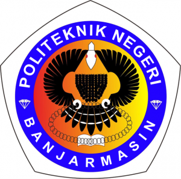

<div align="center">



🗺️ SIG SEKOLAH

### Peta Digital Pendidikan yang Aman, Terpadu, dan Terpercaya

*Satu peta, satu data, satu sumber kebenaran untuk dunia pendidikan.*


</div>

---

## 🎓 Identitas Pengembang

| | |
|---|---|
| **Nama** | Fathur Ramadhan |
| **NIM** | C050425007 |
| **Kelas** | SIKC 3B |
| **Program Studi** | Sistem Informasi Kota Cerdas |
| **Jurusan** | Teknik Elektro |
| **Perguruan Tinggi** | Politeknik Negeri Banjarmasin |
| **Mata Kuliah** | Pemrograman Berbasis Web |
| **Dosen Pengampu** | Arifin Noor Asyikin, S.T.,M.T. |
| **Tahun Akademik** | [2026/2027] |

---

## 🌟 Tentang Sistem

**SIG Sekolah** adalah aplikasi web berbasis Sistem Informasi Geografis yang memetakan sebaran sekolah (SD, SMP, SMA, dan SMK) dan mengelola datanya dengan **autentikasi serta hak akses berbasis peran (RBAC)**.

Bagi masyarakat, sistem ini adalah **peta publik** yang terbuka: siapa pun dapat mencari sekolah, melihat lokasi, dan membaca profilnya. Bagi pengelola, sistem ini adalah **ruang kerja yang terkontrol**: setiap orang hanya dapat melakukan apa yang menjadi kewenangannya, dan setiap perubahan tercatat.

> **Terbuka untuk dilihat, tertutup untuk disalahgunakan.**

---

## 💡 Narasi Branding

**Nama:** SIG Sekolah
**Tagline:** *Peta Digital Pendidikan yang Aman, Terpadu, dan Terpercaya.*

Setiap sekolah punya cerita, dan setiap cerita bermula dari satu titik di peta. SIG Sekolah hadir untuk mempertemukan **lokasi, data, dan kepercayaan** dalam satu platform.

| Nilai | Makna |
|---|---|
| 🧭 **Terarah** | Orang tua dan masyarakat menemukan sekolah dengan cepat lewat peta interaktif. |
| 🔐 **Aman** | Hak akses berlapis memastikan data hanya diubah oleh pihak yang berwenang. |
| 📋 **Akuntabel** | Setiap perubahan data tercatat: siapa, apa, dan kapan. |
| 🤝 **Terpadu** | Dinas Pendidikan dan sekolah bekerja pada satu sumber data yang sama. |
| 🌐 **Terbuka** | Informasi yang layak publik dapat diakses tanpa login. |

---

## ✨ Fitur Utama

### 🌍 Peta Publik (tanpa login)
- Peta interaktif berbasis **Leaflet** dengan pilihan peta dasar *OpenStreetMap* dan *Topografi*.
- Marker berwarna per jenjang: 🔵 SD, 🟢 SMP, 🟠 SMA, 🔴 SMK.
- *Marker cluster* agar peta tetap rapi saat banyak sekolah.
- Filter **jenjang** dan **status** (Negeri/Swasta), serta pencarian nama sekolah.
- Popup memuat logo, kepala sekolah, akreditasi, jumlah siswa, dan jumlah guru.
- Halaman **profil publik** tiap sekolah lewat tautan *Lihat profil lengkap*.

### 🔐 Autentikasi dan Keamanan
- Login dan logout berbasis *session* dengan regenerasi session (anti *session fixation*).
- Perlindungan **CSRF** pada setiap form.
- Pembatasan percobaan login **5 kali per menit** (anti *brute force*).
- Pesan kesalahan seragam agar email terdaftar tidak bisa ditebak.
- Kata sandi disimpan sebagai **hash**.
- Ubah kata sandi mandiri untuk semua pengguna.
- **Penonaktifan akun** (`is_active`): akun nonaktif ditolak login, dan yang sedang login langsung dikeluarkan.

### 🛡️ Hak Akses Dua Lapis
- **Middleware role** sebagai *pintu gedung*: menentukan role mana yang boleh masuk ke suatu kelompok halaman.
- **Policy** sebagai *kunci ruangan*: menentukan apakah pengguna boleh mengubah data sekolah tertentu.
- Terlindung dari kerentanan **IDOR** (mengganti id pada URL).
- **NPSN dikunci** di sisi server untuk role sekolah.
- Pembatasan perubahan koordinat role sekolah maksimal **500 meter** dari titik semula.
- Role dikelola sebagai **PHP Backed Enum**.

### 📝 Pengelolaan Data
- CRUD sekolah oleh Dinas Pendidikan.
- Profil sekolah: kepala sekolah, email, website, tahun berdiri, akreditasi, jumlah siswa, jumlah guru, deskripsi, dan **logo**.
- Kelola pengguna oleh Admin, termasuk menautkan akun operator ke sekolahnya.
- **Log aktivitas** otomatis (Observer): mencatat pelaku, waktu, dan nilai lama → baru.

---

## 👥 Peran Pengguna

| Peran | Siapa | Tanggung jawab |
|---|---|---|
| 🌐 **Publik** | Masyarakat umum | Melihat peta dan profil publik sekolah. |
| 🛠️ **Admin** | Pengelola sistem | Mengelola akun pengguna (tambah, ubah, hapus, aktif/nonaktif). Tidak mengelola data sekolah. |
| 🏛️ **Dinas Pendidikan** | Pengelola data | Mengelola seluruh data dan profil sekolah, serta melihat log aktivitas. |
| 🏫 **Sekolah** | Operator sekolah | Mengubah data dan profil sekolahnya sendiri. |

### Matriks Hak Akses

| Fitur | Admin | Dinas | Sekolah | Publik |
|---|:---:|:---:|:---:|:---:|
| Melihat peta dan profil publik | ✅ | ✅ | ✅ | ✅ |
| Login dan dashboard | ✅ | ✅ | ✅ | ❌ |
| Ubah kata sandi sendiri | ✅ | ✅ | ✅ | ❌ |
| Kelola pengguna | ✅ | ❌ | ❌ | ❌ |
| Daftar, tambah, hapus sekolah | ❌ | ✅ | ❌ | ❌ |
| Ubah data dan profil sekolah | ❌ | Semua sekolah | Milik sendiri | ❌ |
| Unggah logo | ❌ | Semua sekolah | Milik sendiri | ❌ |
| Ubah koordinat | ❌ | Bebas | Maks. 500 m | ❌ |
| Lihat log aktivitas | ✅ | ✅ | ❌ | ❌ |

---

## 🧰 Teknologi

| Lapisan | Teknologi |
|---|---|
| Framework | Laravel 12 |
| Bahasa | PHP 8.2 |
| Basis data | MySQL / MariaDB (XAMPP) |
| Antarmuka | Blade, Tailwind CSS, Vite |
| Peta | Leaflet 1.9.4, Leaflet.markercluster |
| Pengujian | PHPUnit (Feature Test) |

---

## 🚀 Instalasi

**Prasyarat:** XAMPP (PHP 8.2 dan MySQL), Composer, Node.js, dan Git.

```bash
# 1. Salin proyek
git clone [URL-repositori-anda] sig-sekolah
cd sig-sekolah

# 2. Pasang dependensi
composer install
npm install

# 3. Siapkan lingkungan
cp .env.example .env
php artisan key:generate
```

Atur koneksi basis data di `.env`:

```env
DB_CONNECTION=mysql
DB_DATABASE=sig_sekolah
DB_USERNAME=root
DB_PASSWORD=
SESSION_DRIVER=database
APP_URL=http://127.0.0.1:8000
```

```bash
# 4. Buat database "sig_sekolah" di phpMyAdmin, lalu:
php artisan migrate
php artisan db:seed
php artisan storage:link

# 5. Jalankan (dua terminal)
npm run dev
php artisan serve
```

Buka **http://127.0.0.1:8000**.

---

## 🔑 Akun Demo

| Peran | Email | Kata sandi |
|---|---|---|
| Admin | `admin@sig.test` | `password123` |
| Dinas Pendidikan | `dinas@sig.test` | `password123` |
| Operator Sekolah 1 | `sekolah1@sig.test` | `password123` |
| Operator Sekolah 2 | `sekolah2@sig.test` | `password123` |

> ⚠️ Akun ini **hanya untuk praktikum**. Pada penggunaan nyata, gunakan kata sandi yang kuat dan unik.

---

## 🗂️ Peta Rute

| URL | Akses | Fungsi |
|---|---|---|
| `/` | Publik | Peta publik |
| `/sekolah/{id}` | Publik | Profil publik sekolah |
| `/login` | Tamu | Halaman login |
| `/dashboard` | Semua role | Ringkasan sesuai role |
| `/kata-sandi` | Semua role | Ubah kata sandi |
| `/log-aktivitas` | Admin, Dinas | Riwayat perubahan data |
| `/admin/users` | Admin | Kelola pengguna |
| `/dinas/sekolah` | Dinas | Daftar, tambah, hapus sekolah |
| `/sekolah/{id}/edit` | Dinas, Sekolah (Policy) | Ubah data sekolah |
| `/sekolah/{id}/profil` | Dinas, Sekolah (Policy) | Ubah profil sekolah |

---

## 🧪 Pengujian

```bash
php artisan test --filter=RbacTest
```

Pengujian otomatis memverifikasi: tamu dialihkan ke login, pembatasan per role, Policy antar sekolah, NPSN tidak dapat diubah, batas koordinat, akun nonaktif, ubah kata sandi, unggah logo, log aktivitas, dan profil publik.

---

## 🏗️ Struktur Penting

```
app/
├── Enums/Role.php                      # Role sebagai backed enum
├── Http/
│   ├── Controllers/                    # Auth, Dashboard, Sekolah, Profil, User, dll.
│   └── Middleware/                     # RoleMiddleware, EnsureUserIsActive
├── Models/                             # User, Sekolah, ProfilSekolah, ActivityLog
├── Observers/SekolahObserver.php       # Pencatat log aktivitas
└── Policies/SekolahPolicy.php          # Kunci akses per data sekolah
resources/views/                        # auth, admin, sekolah, log, peta, errors
routes/web.php
tests/Feature/RbacTest.php
```

---

## 🔒 Prinsip Keamanan

1. **Sembunyikan menu saja tidak cukup.** Setiap route dilindungi di sisi server.
2. **Dua lapis:** middleware menjaga pintu, Policy menjaga kunci.
3. **Validasi di server.** Atribut `readonly` hanya tampilan, keputusan akhir ada di controller.
4. **Hanya data layak publik** yang masuk ke peta publik (email dan website sekolah tidak dibuka).
5. **Keluaran di-escape** untuk mencegah XSS.

---

## 📚 Cakupan Praktikum

| No | Materi |
|---|---|
| 10 | Database role dan profil sekolah |
| 11 | Seeder akun demo |
| 12 | Halaman login dan logout |
| 13 | Middleware role |
| 14 | Policy dan pembatasan data sekolah |
| 15 | Profil sekolah |
| 16 | Kelola pengguna (admin) |
| 17 | Profil sekolah pada peta publik |
| 18 | Pengujian, tugas, dan penilaian |
| Mandiri | Ubah kata sandi, `is_active`, log aktivitas, batas koordinat, logo, enum, profil publik |

---

<div align="center">

### 🎓 [Nama Kampus]
**[Fakultas] · [Program Studi]**

Dikembangkan oleh **[Nama Lengkap Anda]** (NIM [NIM Anda])
sebagai tugas Praktikum Sistem Informasi Geografis Lanjutan

*Dari satu titik di peta, lahir akses yang lebih adil terhadap informasi pendidikan.*

</div>